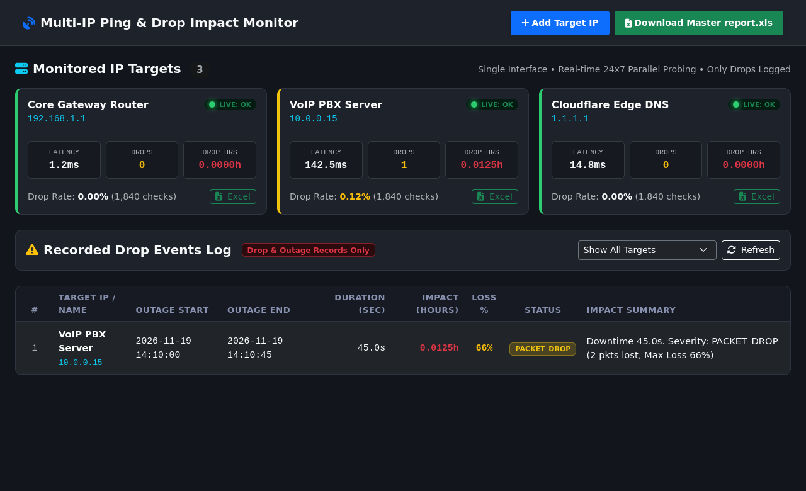

# ping-drop-monitor
# 24x7 Multi-IP Ping & Network Drop Impact Monitor with Web GUI & Excel Reports


A continuous, high-precision network monitoring daemon and responsive web dashboard designed for tracking packet loss, downtime incidents, and **drop impact hours** across multiple IP targets simultaneously over a single network interface.



Unlike generic monitoring tools that clutter databases with millions of successful ping logs, **ping-drop-monitor** logs **ONLY when a drop, timeout, or packet loss occurs**. Reachable pings are discarded from logging, keeping the SQLite database lightweight and Excel audit reports focused 100% on network outages and drop impact analysis.

---

## 🌟 Key Features

* **Multi-IP Parallel Monitoring (Single Interface):** Monitor servers, gateways, VoIP PBXs, and WAN links concurrently using Python thread pools without needing secondary network interfaces.
* **Drop-Only Recording Engine:** Discards normal reachable pings. Records ONLY packet loss and downtime events with precision start times, end times, durations, and severity.
* **Drop Impact Hours Calculation:** Accurately computes cumulative outage durations (in seconds, minutes, and fractional hours) globally, per target, and by hour.
* **Modern Web GUI (Port 8084):**
  * Real-time pulsing status badges (Green = OK, Red = Drop Detected).
  * Target status cards showing live latency (RTT ms), drop counts, drop impact hours, and drop rate %.
  * **1-Click Target Management:** Add or remove target IPs directly from the browser.
  * **1-Click Excel Download:** Export styled Excel reports per IP or all targets combined.
  * Auto-refreshing dashboard (every 10 seconds).
* **Automated Excel (.xls) Generation:**
  * **Individual Reports:** `/ping/report_<IP>.xls` per monitored target.
  * **Master Consolidated Report:** `/ping/report.xls` containing an Executive Summary sheet plus dedicated sheet tabs for each monitored IP.
  * Formatted with custom color coding (Green for Normal, Yellow for Partial Drop, Red for Critical Down).
* **Automated Background Daemon:** Fully integrated with `systemd` (`ping-monitor.service`) with auto-start on boot and automatic self-recovery.

---

## 📁 Repository Structure

```text
ping-drop-monitor/
├── monitor.py                    # Core daemon: Multi-IP parallel pinger, SQLite DB, Flask GUI
├── targets.example.json          # Example target IP configuration file
├── requirements.txt              # Python dependencies (Flask, xlwt)
├── status.sh                     # Terminal CLI health and stats viewer
├── install.sh                    # 1-click automated installer
├── .gitignore                    # Excludes runtime DBs and generated Excel files
├── systemd/
│   └── ping-monitor.service     # Systemd background service definition
└── templates/
    └── index.html               # Responsive Bootstrap 5 dark-mode dashboard
```

---

## 🚀 Quick Installation (1-Click)

Clone the repository and run the automated installer:

```bash
git clone https://github.com/jacky1473/ping-drop-monitor.git /tmp/ping-drop-monitor
cd /tmp/ping-drop-monitor
chmod +x install.sh
./install.sh
```

The script will:
1. Verify / install Python3 and dependencies (`Flask`, `xlwt`).
2. Deploy the tool to `/ping`.
3. Configure and open firewall port `8084`.
4. Install, enable, and start `ping-monitor.service`.

---

## 🌐 Web Dashboard Access

Open your web browser and navigate to:

```text
http://<your-server-ip>:8084/
```

### Dashboard Capabilities:
* **Add Target IP:** Click the **"Add Target IP"** button in the navbar, enter the IP (e.g. `192.168.2.13`) and Friendly Name (e.g. `VoIP Dialer`), and start monitoring instantly.
* **Live RTT & Drop Rate:** View real-time latency and packet loss rates.
* **Download Excel:** Click **"Download report.xls"** to retrieve the spreadsheet.
* **Remove Target:** Click the delete icon on any card to remove an IP from active probing.

---

## 📊 Terminal CLI Management

Check live statistics directly from the terminal without opening a browser:

```bash
/ping/status.sh
```

### Service Controls:
```bash
# Check service status
systemctl status ping-monitor

# View live service logs
journalctl -u ping-monitor -f

# Restart service
systemctl restart ping-monitor
```

---

## ⚙️ Target Configuration (`/ping/targets.json`)

You can also edit target IPs directly via JSON:

```json
[
  {
    "ip": "192.168.2.13",
    "name": "SANS PBX",
    "enabled": true
  },
  {
    "ip": "192.168.1.1",
    "name": "Default Gateway",
    "enabled": true
  },
  {
    "ip": "8.8.8.8",
    "name": "Google DNS",
    "enabled": true
  }
]
```

---

## 📄 License
This project is open-source under the MIT License.
